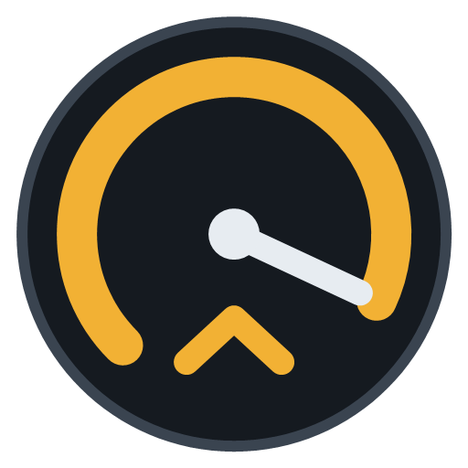
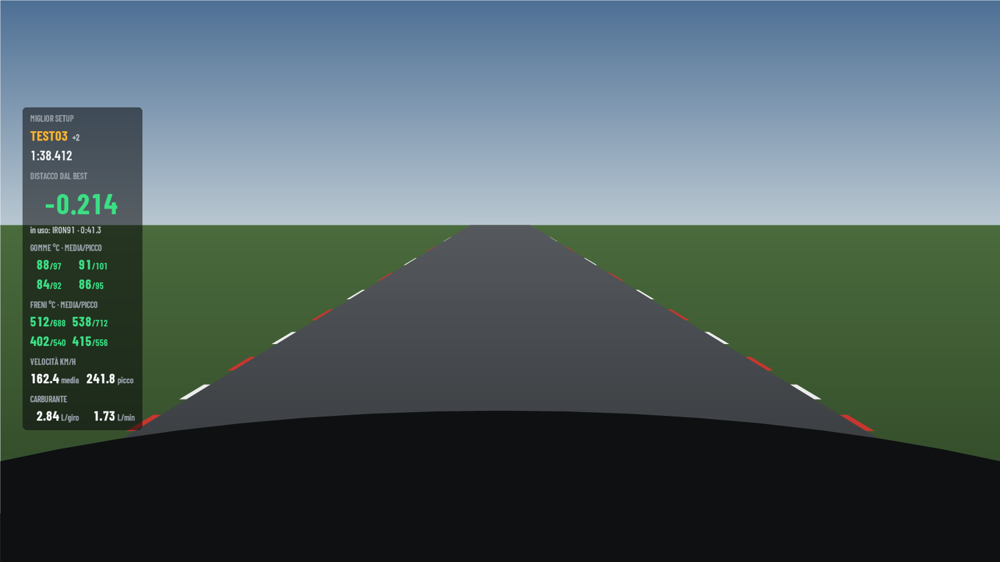
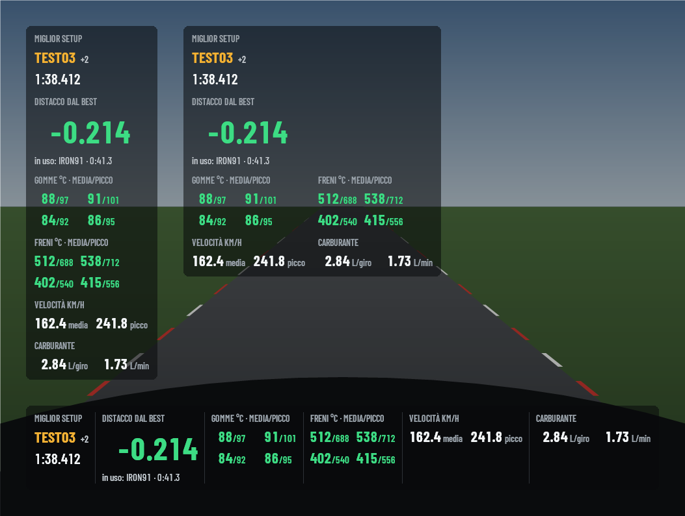

# mybestlap

[English](README.en.md)

Overlay per **Assetto Corsa EVO** che, mentre guidi, mostra come sta andando il setup in uso
rispetto al migliore che hai provato con la stessa auto sulla stessa pista. Ogni giro viene
registrato insieme al setup con cui l'hai fatto, così sai quale assetto ti ha dato il giro più
veloce e dove guadagna o perde.

**[Scarica l'ultima versione](https://github.com/agastal/mybestlap-Release/releases/latest)** ·
[Novità](CHANGELOG.it.md) · [Guida](https://github.com/agastal/mybestlap-Release/wiki)





*Valori di esempio. In alto a sinistra la colonna, a destra la griglia, sotto la barra.*

## Installazione

1. Scarica `mybestlap-<versione>-setup.exe` dall'[ultima release](https://github.com/agastal/mybestlap-Release/releases/latest).
2. Eseguilo: si installa per il tuo utente, senza diritti di amministratore.
3. L'icona compare nell'area di notifica, vicino all'orologio. Avvia Assetto Corsa EVO e guida.

Il gioco va usato **in finestra o a schermo intero senza bordi**: con lo schermo intero esclusivo
un overlay esterno può non vedersi.

Gli aggiornamenti arrivano da soli: quando esce una nuova versione l'app lo dice, e *Installa
l'aggiornamento* nel menu dell'icona la installa con un clic. Impostazioni e giri restano.

## Cosa mostra l'overlay

| Misura | Note |
| --- | --- |
| Miglior setup e il suo tempo | per l'auto e la pista in uso |
| Distacco live dal miglior giro | punto per punto lungo la pista; verde avanti, rosso dietro |
| Setup in uso e tempo del giro | sotto il distacco |
| Temperature gomme e freni, media e picco | per ruota, per asse o una cifra sola |
| Velocità media e di picco | del giro in corso |
| Carburante al giro e al minuto | dell'ultimo giro completato |

Disposizione (colonna, griglia, barra), trasparenza, misure, font e dimensioni si scelgono nelle
**Impostazioni** (doppio clic sull'icona), e l'overlay cambia mentre le modifichi.

## Scorciatoie

| Tasti | Azione |
| --- | --- |
| Ctrl+Shift+F7 | mostra o nasconde l'overlay |
| Ctrl+Shift+F8 | posiziona l'overlay: trascinalo e fissalo con un doppio clic |

Funzionano anche col gioco in primo piano e si cambiano nelle Impostazioni.

## Come riconosce il setup

- Il setup caricato o salvato dalla pagina setup del gioco.
- Anche le **modifiche non salvate**: un giro fatto con "TEST03 + campanatura" è una variante a sé.
  Se poi la salvi con un nome, i giri già fatti prendono quel nome.
- Il setup è quello in vigore quando esci dai box; il carburante non conta.
- Se cancelli un setup dal gioco, i suoi giri escono dall'archivio.

Per miglior giro e distacco contano solo i giri validi cominciati sulla linea: il giro di lancio
dai box no.

## Confronto setup

Dal menu dell'icona, **Confronto setup** apre nel browser una pagina dove scegli auto e pista.
**Tempi**: i setup dal migliore, con miglior giro, mediana, i tre settori (e quanto guadagnano o
perdono) e i **giri puliti**, cioè quanti giri sono stati validi e senza scivolate, uscite di pista
o contatti. **Comportamento**: temperature, velocità, carburante e bilanciamento
(sottosterzo/sovrasterzo); il valore migliore di ogni colonna è in verde.
[Più dettagli nella guida](https://github.com/agastal/mybestlap-Release/wiki/Confronto-setup).

## Privacy

Tutto resta sul tuo PC, in `%LOCALAPPDATA%\mybestlap`. L'app legge in sola lettura la memoria
condivisa del gioco, il suo log e la cartella dei setup; non modifica niente del gioco. Non invia
niente: l'unica connessione è il controllo degli aggiornamenti su questo repository, una volta al
giorno, che si può spegnere nelle Impostazioni.

## Verificare il file scaricato

Ogni release ha `SHA256SUMS.txt` e `antivirus.txt` (una scansione Microsoft Defender di quel
setup). Il setup non ha una firma digitale, quindi Windows può avvisarti al primo avvio.

```powershell
Get-FileHash mybestlap-<versione>-setup.exe -Algorithm SHA256
```

---

*Progetto amatoriale non ufficiale, non affiliato con Assetto Corsa EVO, Kunos Simulazioni o 505 Games.*
Font inclusi con licenza SIL Open Font License: Barlow Condensed, Chakra Petch, JetBrains Mono, IBM Plex Sans.
